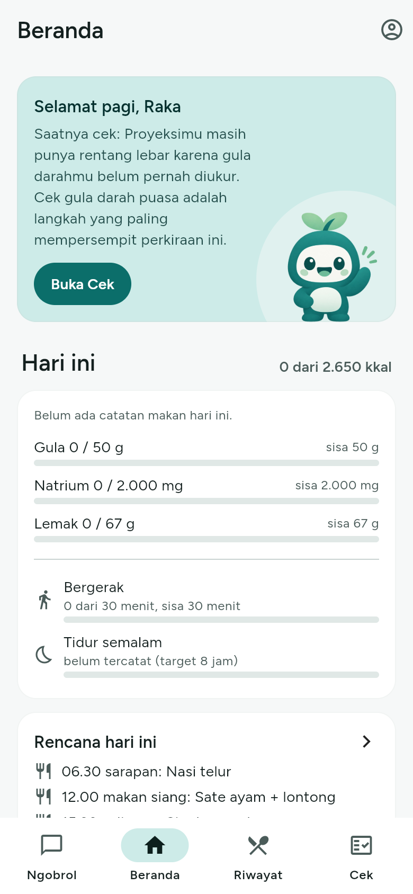
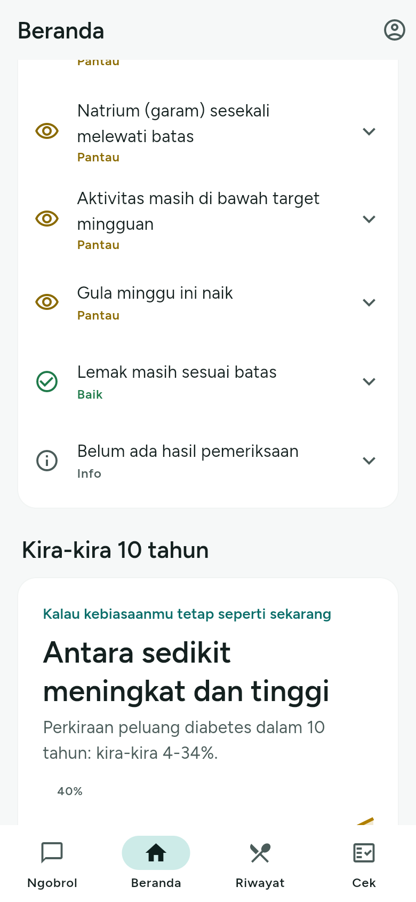
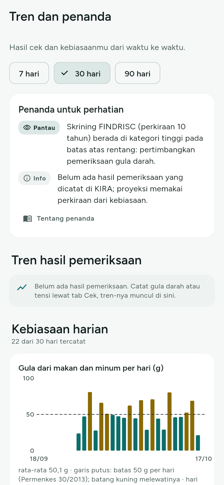
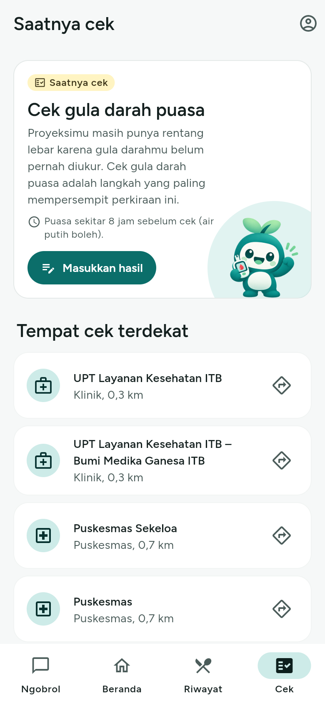
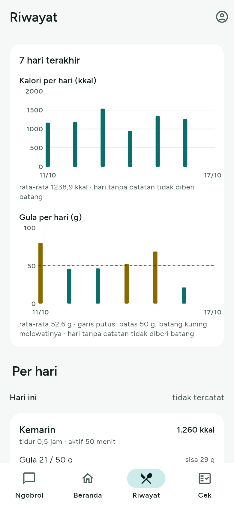
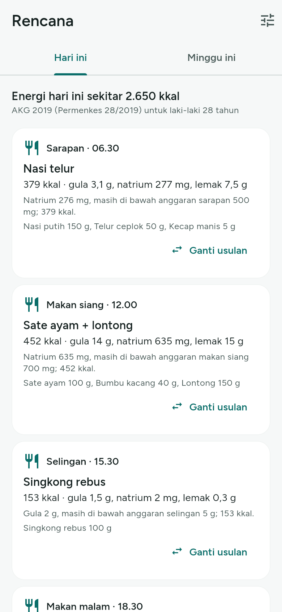

<div align="center">
  
  <h1>KIRA</h1>
  <h3>What might your health look like ten years from now?</h3>
  <p>A one-minute-a-day chat companion that projects your diabetes and hypertension risk, shows the habits that matter most, and knows when you should get checked.</p>
  <p>
    
    
    
    
    
    
  </p>
  <p>
    <a href="https://github.com/andi-frame/KIRA/releases/latest/download/kira.apk"><strong>Download APK</strong></a>
    &nbsp;·&nbsp;
    <a href="https://youtu.be/kZrauw0OmNg">Demo video</a>
    &nbsp;·&nbsp;
    <a href="https://github.com/andi-frame/KIRA/releases/latest">Release notes</a>
  </p>
</div>

---

## Overview

Most people only learn about diabetes or hypertension once it has already happened. Getting checked feels unnecessary while nothing hurts, and long health questionnaires are easy to abandon.

**KIRA** turns that around with one minute a day. Users tell KIRA about their day in their own words, by text, voice, or photo. KIRA turns it into food, drink, sleep, and activity records, projects the 10-year diabetes risk as an honest range instead of a single scary number, shows which habit would move that range the most, and tells the user when a check-up is worth it and where to go. When a test result comes in, the projection recalibrates.

> KIRA is not a diagnostic tool. It never gives a diagnosis, medication, or dosage advice. All data in this repository is dummy data.

---

## Key Features

### Daily check-in by chat
- Log meals, drinks, sleep, and exercise by text, voice, or photo
- Photos of food, receipts, nutrition labels, and lab results
- Dishes are broken into their components, each with its own nutrition, and every portion can be corrected
- Barcode scanning for packaged food
- "See how KIRA calculated this" for every number in a reply

### 10-year projection
- Diabetes risk over 10 years, always shown as a range
- Hypertension risk when blood pressure and profile allow it
- What-if view: current habits and improved habits as two curves side by side
- The single habit with the biggest impact on the range

### Knowing when to get checked
- Recommends the one test that narrows the range the most, with preparation tips
- Nearby puskesmas and clinics from live map data, with directions
- Test results recalibrate the projection; a confirmed diagnosis switches KIRA to management mode
- Guided 7-day home blood pressure protocol

### Home, history, and plans
- Today at a glance: sugar, sodium, and fat against daily limits, plus activity and sleep, written in words, not only colors
- Habit signals from the past week
- Daily and weekly plans for meals, exercise, and bedtime
- History by day with edit and delete for every record
- Trends and markers for blood pressure, blood sugar, and heart rate

### Sharing and connections
- One-page doctor summary as a PDF or a temporary, revocable link
- Personal medical records: diagnoses, lab results, medication, and allergies
- Family sharing limited to what the user allows
- Optional steps and sleep from Health Connect
- Optional reminders and a short card before opening social media apps
- WhatsApp check-in bridge (prototype)

### Privacy and safety
- Red-flag symptoms and dangerous readings get an emergency reply before any AI model is called
- Consent before registration, full data export, account deletion, and a log of who opened your summary
- Notifications never contain health data
- Messages sent without signal are queued on the phone and delivered once, without duplicates

---

## How It Works

```
Check-in (text / voice / photo)
        │
        ▼
  AI extraction ──► food, drink, sleep, and activity records
        │
        ▼
  10-year projection (a range, not one number) ──► what-if: two curves side by side
        │
        ▼
  Wide range or rising risk ──► "Time to get checked" (most useful test + nearby facilities)
        │
        ▼
  Test result entered ──► projection recalibrated ──► confirmed diagnosis → management mode
```

**Numbers never come from the language model.** Risk scores, nutrition, daily targets, triage markers, and goals are computed by pure, tested Python functions. The language model only extracts structured data from what the user says, decides which tool to call, and phrases the reply. Every reply passes an output guardrail that rejects diagnosis, medication advice, and false reassurance.

The chat pipeline runs on LangGraph:

```
safety_check → extract → save_logs → build_context → agent ⇄ tools → output_guardrail
```

---

## Tech Stack

<div align="center">
  <table>
    <tr>
      <th>Layer</th>
      <th>Technology</th>
      <th>Purpose</th>
    </tr>
    <tr>
      <td align="center"></td>
      <td><strong>Flutter</strong><br>Riverpod, go_router, Dio, fl_chart</td>
      <td>Android app (web build for the prototype link)</td>
    </tr>
    <tr>
      <td align="center"></td>
      <td><strong>FastAPI</strong><br>SQLAlchemy 2 (async), Alembic, APScheduler</td>
      <td>REST API, weekly summaries, check reminders, and scheduled jobs</td>
    </tr>
    <tr>
      <td align="center"></td>
      <td><strong>PostgreSQL 16</strong></td>
      <td>Users, logs, results, plans, and the local food catalog</td>
    </tr>
    <tr>
      <td align="center"></td>
      <td><strong>LangGraph</strong><br>Claude or any OpenAI-compatible model, Whisper</td>
      <td>Extraction, tool calling, vision, and speech-to-text</td>
    </tr>
    <tr>
      <td align="center"></td>
      <td><strong>Node.js</strong><br>Baileys</td>
      <td>WhatsApp bridge (prototype)</td>
    </tr>
  </table>
</div>

---

## Screenshots

<div align="center">
  <table>
    <tr>
      <td align="center"><br><b>Home</b></td>
      <td align="center"><br><b>10-year projection</b></td>
      <td align="center"><br><b>Trends and markers</b></td>
    </tr>
    <tr>
      <td align="center"><br><b>Time to get checked</b></td>
      <td align="center"><br><b>History</b></td>
      <td align="center"><br><b>Daily plan</b></td>
    </tr>
  </table>
</div>

---

## Try It

1. Download **[kira.apk](https://github.com/andi-frame/KIRA/releases/latest/download/kira.apk)** on an Android phone (Android 8.0 or later).
2. Open the file and allow installs from this source when asked.
3. Sign in with the demo account **raka**, PIN **123456**, or create your own account.

The release build connects to the hosted API at `https://kira-be.byhan.id`.

---

## Project Structure

```
KIRA/
├── app/          Flutter app (Android first, web build for the prototype)
├── backend/      FastAPI + LangGraph API, clinical calculations, migrations, seed data
├── wa-bot/       Node.js WhatsApp bridge (prototype)
├── docs/         Product, clinical sources, privacy, deployment, screenshots
└── docker-compose.yml
```

---

## Installation & Setup

### Prerequisites
- Docker
- [uv](https://docs.astral.sh/uv/) for Python and dependencies
- Flutter 3.47 or later
- Node.js 20 or later (only for the WhatsApp bridge)

### Database

```bash
cp .env.example .env
docker compose up -d db          # PostgreSQL on localhost:5455
```

### Backend

```bash
cd backend
uv sync
uv run alembic upgrade head
uv run python -m seed.load              # local foods and sample health facilities
uv run python -m seed.raka --reset      # demo user: raka / 081234567890, PIN 123456
SCHEDULER_ENABLED=false uv run uvicorn app.main:app --port 8000
```

### App

```bash
cd app
flutter pub get

# Against the local backend
flutter run -d chrome --dart-define=API_URL=http://localhost:8000
flutter run --dart-define=API_URL=http://10.0.2.2:8000     # Android emulator

# Against the hosted API (default when API_URL is not set)
flutter run

# Release builds
flutter build apk --release
flutter build web --release --dart-define=API_URL=https://<your-server>
```

### WhatsApp bridge (optional)

```bash
cd wa-bot
npm install
npm start
```

The channel is disabled while `BOT_SECRET` is empty.

### Environment Variables

Copy `.env.example` to `.env` at the repository root and fill in your own values. Never commit real keys.

| Variable | Purpose |
|---|---|
| `DATABASE_URL`, `TEST_DATABASE_URL` | PostgreSQL connection (asyncpg) |
| `JWT_SECRET` | Signing key for sessions, a random string of 32+ characters |
| `ANTHROPIC_API_KEY`, `LLM_MODEL_CHAT`, `LLM_MODEL_EXTRACT` | Chat, vision, and extraction models (Anthropic when `LLM_BASE_URL` is empty) |
| `LLM_BASE_URL`, `LLM_API_KEY` | Any OpenAI-compatible provider instead of Anthropic |
| `LLM_HEDGE_AFTER_SECONDS` | Starts a second model call when the first is slow; `0` disables it |
| `STT_BASE_URL`, `STT_API_KEY`, `STT_MODEL` | Speech-to-text |
| `DEMO_CACHE` | `true` serves scripted demo sentences without calling a model |
| `CORS_ORIGINS` | Browser origins allowed to call the API, comma-separated |
| `ENVIRONMENT` | `production` refuses to start with a default or short `JWT_SECRET` |
| `BOT_SECRET` | Shared secret with the WhatsApp bridge; empty disables the channel |
| `PUBLIC_BASE_URL` | Public API address, used for doctor summary links |
| `SCHEDULER_ENABLED` | Runs weekly summaries, nightly check-ups, and reminders inside the API |

---

## Testing

```bash
cd backend && uv run pytest -q     # clinical calculations, chat graph, API, scheduler (needs PostgreSQL)
cd app && flutter test             # widget tests for every screen and the theme contrast
cd wa-bot && npm test              # WhatsApp bridge logic, no real connection
```

The tests focus on what produces numbers and on the safety path: red flags never reach the language model, a user ID cannot be spoofed through a tool call, the guardrail rejects medication advice and diagnosis, and impossible clinical values are rejected before they are saved.

---

## Limitations

- The 10-year projection covers diabetes; hypertension risk is a 4-year estimate and only appears when its eligibility criteria are met.
- Health Connect and the real WhatsApp connection have not been tested on a physical device yet.
- SATUSEHAT integration is not implemented.
- A production launch would need the official WhatsApp Business Platform, real OTP, and a reviewed privacy process.

---

## Roadmap

- SATUSEHAT integration for verified lab results
- Official WhatsApp Business Platform channel
- iOS app with Apple Health
- Wider local food coverage with verified nutrition data

---

## Team

<div align="center">
  <table>
    <tr>
      <td align="center"><b>Andi Farhan Hidayat</b><br><a href="https://github.com/andi-frame">@andi-frame</a></td>
      <td align="center"><b>Muhammad Dicky Isra</b><br><a href="https://github.com/DaDecky">@DaDecky</a></td>
      <td align="center"><b>Carlo Angkisan</b><br><a href="https://github.com/carllix">@carllix</a></td>
      <td align="center"><b>Samantha Laqueenna Ginting</b><br><a href="https://github.com/sammmine">@sammmine</a></td>
    </tr>
  </table>
</div>

---

<div align="center">
  <p><strong>Made by Team KIRA © 2026</strong></p>
</div>
